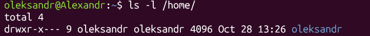

# Bash: командная оболочка и синтаксис команд

[← Оглавление](../../README.md) · [Справочник команд](commands-and-examples.md)

## Терминал и оболочка

**Терминал** предоставляет интерфейс для ввода текста и отображения вывода программ.

**Командная оболочка (shell)** — программа, которая принимает и интерпретирует команды пользователя: выполняет встроенные команды и запускает другие программы. Один из примеров оболочки — **Bash**.

## Приглашение Bash

Приглашение командной строки может выглядеть так:

```text
oleksandr@Alexandr:~$
```

| Часть | Значение |
| --- | --- |
| `oleksandr` | Имя пользователя |
| `Alexandr` | Имя компьютера |
| `~` | Домашний каталог пользователя; в этом примере это текущий каталог |
| `$` | Обычно обозначает работу от имени обычного пользователя |

Внешний вид приглашения можно настраивать. Его не нужно вводить вместе с командой.

## Формат команды

Типичная структура команды:

```text
команда [опции] [аргументы]
```

- **Команда** — что выполнить.
- **Опции (ключи)** — как изменить поведение команды.
- **Аргументы** — с какими файлами, каталогами или другими данными работать.

Квадратные скобки обозначают необязательные части; вводить сами скобки не нужно.

```bash
ls -l /home/
```

В этом примере `ls` — команда, `-l` — опция подробного вывода, `/home/` — аргумент: каталог для просмотра.



## Порядок выполнения

Bash не выполняет все команды «справа налево». Порядок зависит от синтаксиса:

- В `pwd; ls` команды выполняются последовательно: сначала `pwd`, затем `ls`.
- В `ls -l /etc/ | less` команды соединены конвейером: вывод `ls` поступает на вход `less`. Они могут работать одновременно.
- Перенаправления одной команды обрабатываются слева направо.

Подробнее: [потоки, перенаправления и конвейеры](streams-redirection-and-pipes.md).
