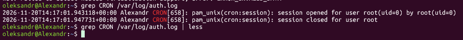

# Команды Linux: справочник с примерами

[← Оглавление](../../README.md) · [Потоки и перенаправления](streams-redirection-and-pipes.md)

## Быстрый поиск

| Задача                                        | Команда         |
| --------------------------------------------- | --------------- |
| Узнать текущий каталог                        | [pwd](#pwd)     |
| Перейти в другой каталог                      | [cd](#cd)       |
| Посмотреть файлы, включая скрытые             | [ls](#ls)       |
| Создать файл или обновить его временные метки | [touch](#touch) |
| Создать каталог                               | [mkdir](#mkdir) |
| Удалить файл или дерево каталогов             | [rm](#rm)       |
| Удалить пустой каталог                        | [rmdir](#rmdir) |
| Вывести содержимое файла                      | [cat](#cat)     |
| Просмотреть длинный файл с прокруткой         | [less](#less)   |
| Скопировать файл или каталог                  | [cp](#cp)       |
| Посмотреть начало файла                       | [head](#head)   |
| Посчитать строки, слова и байты                | [wc](#wc)       |
| Найти строки с нужным текстом                  | [grep](#grep)   |
| Узнать UID, GID и группы пользователя          | [id](#id)       |
| Изменить права файла или каталога             | [chmod](#chmod) |
| Вывести текст или значение переменной         | [echo](#echo) |
| Проверить успешный и неуспешный код возврата   | [true / false](#true) |
| Узнать, как оболочка понимает имя команды     | [type](#type) |
| Найти бинарный файл и страницы руководства    | [whereis](#whereis) |
| Посмотреть переменные окружения               | [env](#env) |
| Передать переменную дочерним программам       | [export](#export) |
| Запустить Bash-скрипт или проверить синтаксис  | [bash](#bash) |
| Найти пакет в метаданных репозиториев          | [apt-cache](#apt-cache) |
| Обновить списки пакетов или установить пакет   | [apt-get](#apt-get) |
| Проверить статус пакета Debian/Ubuntu         | [dpkg](#dpkg) |
| Посмотреть состояние службы или управлять ею  | [systemctl](#systemctl) |
| Найти слушающие сокеты и процессы             | [ss](#ss), [netstat](#netstat) |
| Посмотреть процессы                          | [ps](#ps) |
| Запросить DNS-сервер                          | [nslookup](#nslookup) |
| Проверить имя через системные источники       | [getent](#getent) |
| Проверить HTTP-ответ                          | [curl](#curl) |
| Проверить конфигурацию Apache                 | [apache2ctl](#apache2ctl) |
| Проверить конфигурацию Nginx                  | [nginx](#nginx) |

Примеры предназначены для Bash в Linux. Имена `notes.txt`, `backup` и другие пути заменяй на свои; исходные файлы и каталоги в примерах должны существовать, если команда их не создаёт.

## pwd

Выводит полный путь к текущему рабочему каталогу. Название — _print working directory_.

```bash
pwd
```

Пример результата: `/home/oleksandr`.

## cd

Меняет текущий каталог оболочки.

| Пример          | Результат                                      |
| --------------- | ---------------------------------------------- |
| `cd /etc`       | Перейти по абсолютному пути                    |
| `cd notes`      | Перейти в подкаталог `notes` текущего каталога |
| `cd ..`         | Перейти в родительский каталог                 |
| `cd ~` или `cd` | Перейти в домашний каталог                     |
| `cd -`          | Вернуться в предыдущий рабочий каталог         |

Подробнее: [абсолютные и относительные пути](../3-files-and-rules/filesystem-paths-and-filenames.md).

## ls

Показывает содержимое каталога. Без аргумента использует текущий каталог.

| Пример         | Результат                                                 |
| -------------- | --------------------------------------------------------- |
| `ls`           | Список без скрытых имён                                   |
| `ls -l`        | Подробный список: права, владелец, размер и другие данные |
| `ls -a`        | Все имена, включая скрытые, а также `.` и `..`            |
| `ls -la`       | Подробный список, включая скрытые имена                   |
| `ls /`         | Содержимое корневого каталога                             |
| `ls -l /home/` | Подробный список содержимого `/home/`                     |

## touch

Создаёт пустой файл, если его ещё нет. Если файл существует, обновляет время доступа и изменения, сохраняя содержимое.

```bash
touch notes.txt
```

Можно указать несколько имён:

```bash
touch lecture-01.txt lecture-02.txt
```

## mkdir

Создаёт каталоги.

```bash
mkdir notes
```

Опция `-p` создаёт недостающие родительские каталоги и допускает, что указанный каталог уже существует:

```bash
mkdir -p notes/linux/terminal
```

## rm

Удаляет файлы. Опция `-r` позволяет рекурсивно удалить каталог вместе с содержимым.

| Пример            | Результат                                       |
| ----------------- | ----------------------------------------------- |
| `rm notes.txt`    | Удалить файл                                    |
| `rm -i notes.txt` | Запросить подтверждение перед удалением файла   |
| `rm -r old-notes` | Удалить каталог `old-notes` вместе с содержимым |

`rm` удаляет данные без перемещения в корзину. Перед запуском проверяй путь, особенно с опцией `-r`.

## rmdir

Удаляет **только пустые** каталоги.

```bash
rmdir empty-notes
```

У `rmdir` нет опции `-r`. Для удаления каталога с содержимым используют `rm -r`.

## cat

Выводит содержимое файлов; при нескольких аргументах объединяет их вывод в указанном порядке.

```bash
cat notes.txt
```

```bash
cat lecture-01.txt lecture-02.txt
```

Без файловых аргументов читает из стандартного ввода:

```bash
cat < notes.txt
```

Подробнее: [стандартные потоки и перенаправления](streams-redirection-and-pipes.md).

## less

Позволяет просматривать текст с прокруткой.

```bash
less notes.txt
```

| Клавиша                 | Действие                  |
| ----------------------- | ------------------------- |
| `↑`, `↓`                | Прокрутить на одну строку |
| `Space`                 | Следующая страница        |
| `b`                     | Предыдущая страница       |
| `/текст`, затем `Enter` | Найти текст вперёд        |
| `n`                     | Следующее совпадение      |
| `q`                     | Выйти                     |

Можно просматривать вывод другой команды:

```bash
ls -l /etc/ | less
```

## cp

Копирует файлы и каталоги. Сначала указывается источник, затем назначение:

```text
cp [опции] источник назначение
```

| Пример                           | Результат                                                  |
| -------------------------------- | ---------------------------------------------------------- |
| `cp notes.txt notes-copy.txt`    | Скопировать файл под другим именем                         |
| `cp notes.txt backup/`           | Скопировать файл в существующий каталог `backup`           |
| `cp -r notes notes-backup`       | Скопировать каталог `notes` в новый каталог `notes-backup` |
| `cp -i notes.txt notes-copy.txt` | Запросить подтверждение, если целевой файл уже существует  |

Если назначение — существующий файл, `cp` обычно перезаписывает его. Если назначение — существующий каталог, копия помещается внутрь него.

## head

Выводит начало файла: по умолчанию **первые 10 строк**. Опция `-n` задаёт нужное количество строк.

| Пример | Результат |
| --- | --- |
| `head notes.txt` | Показать первые 10 строк файла |
| `head -n 5 notes.txt` | Показать первые 5 строк файла |
| `ls -l /etc/ \| head -n 5` | Показать первые 5 строк вывода `ls`, включая строку `total`, если она есть |

## wc

Подсчитывает данные во входном тексте. Без опций выводит количество **символов перевода строки, слов и байтов**, затем имя файла, если он указан.

| Пример | Результат |
| --- | --- |
| `wc notes.txt` | Посчитать переводы строк, слова и байты |
| `wc -l notes.txt` | Посчитать символы перевода строки |
| `wc -w notes.txt` | Посчитать слова |
| `wc -c notes.txt` | Посчитать байты |
| `wc -m notes.txt` | Посчитать символы с учётом текущей локали |
| `cat notes.txt \| wc -l` | Посчитать переводы строк в стандартном вводе |

Обычно `wc -l` используют для подсчёта строк. Если последняя строка не заканчивается переводом строки, она не увеличивает этот счётчик.

## grep

Ищет строки, соответствующие шаблону, и выводит найденные строки. По умолчанию шаблон — регулярное выражение, а поиск учитывает регистр.

```text
grep [опции] шаблон [файл...]
```

| Пример | Результат |
| --- | --- |
| `grep 'error' app.log` | Найти строки с `error` |
| `grep -i 'error' app.log` | Найти совпадения без учёта регистра: например, `error`, `Error`, `ERROR` |
| `grep -n 'error' app.log` | Добавить номера найденных строк |
| `grep -r 'error' logs/` | Искать рекурсивно в файлах каталога `logs` |
| `grep -v 'DEBUG' app.log` | Вывести строки, в которых нет совпадения с `DEBUG` |
| `grep -F '192.168.1.1' app.log` | Искать буквальный текст, не интерпретируя точки как часть регулярного выражения |
| `grep -c 'error' app.log` | Посчитать строки с совпадениями, а не число отдельных совпадений |

### Пример: записи CRON в журнале

```bash
grep 'CRON' /var/log/auth.log
```

Для просмотра результата с прокруткой:

```bash
grep 'CRON' /var/log/auth.log | less
```



Путь `/var/log/auth.log` приведён из примера лекции: наличие этого файла и доступ к нему зависят от системы.

## id

Показывает идентификаторы пользователя и его групп. Без аргумента выводит сведения о текущем пользователе; с именем — об указанной учётной записи.

| Пример | Результат |
| --- | --- |
| `id` | UID, GID и группы текущего пользователя |
| `id root` | Идентификаторы и группы пользователя `root`; его UID — `0` |
| `id oleksandr` | Сведения о пользователе `oleksandr`, если он существует |
| `id -u` | Только UID текущего пользователя |
| `id -g` | Только GID основной группы |
| `id -G` | Идентификаторы всех групп текущего пользователя |

Подробнее: [пользователи, группы и права доступа](../3-files-and-rules/files-and-access-permissions.md).

## chmod

Меняет права доступа к файлам и каталогам. Выполнять команду обычно может владелец объекта или привилегированный пользователь.

| Пример | Результат |
| --- | --- |
| `chmod o-r err` | Убрать чтение у остальных пользователей |
| `chmod u-w err` | Убрать запись у владельца файла |
| `chmod u+w err` | Добавить запись владельцу файла |
| `chmod g+r err` | Добавить чтение группе файла |
| `chmod u=rw,g=r,o= err` | Задать обычные права `rw-r-----` |
| `chmod 640 err` | Задать те же обычные права числовой записью |
| `ls -l err` | Проверить результат |

Файл `err` должен существовать. `u`, `g`, `o` обозначают владельца, группу файла и остальных; `+` добавляет права, `-` убирает, `=` задаёт набор для указанной категории.

Подробнее: [символьные и числовые права](../3-files-and-rules/files-and-access-permissions.md).

## echo

Выводит аргументы и перевод строки. Для значений переменных используй двойные кавычки:

```bash
course="DevOps Linux"
echo "$course"
```

`echo "$?"` показывает код предыдущей команды; проверять его нужно сразу после неё.

## true

`true` завершается с кодом `0`, `false` — с кодом `1`. Обе команды ничего не печатают:

```bash
true && echo "Успех"
false || echo "Неуспех"
```

## type

Показывает, как Bash интерпретирует имя команды: как встроенную команду, функцию, псевдоним или внешний исполняемый файл.

| Пример | Результат |
| --- | --- |
| `type bash` | Сведения о команде `bash`, обычно путь к исполняемому файлу |
| `type cd` | Сведения о встроенной команде `cd` |
| `type -a bash` | Все найденные варианты |

## whereis

Ищет бинарные файлы, исходники и страницы руководства команды:

```bash
whereis ls
```

Результат может содержать несколько путей. Для проверки того, что именно запускает Bash, используй `type`.

## env

Без аргументов выводит переменные **окружения**, а не все переменные оболочки:

```bash
env
```

## export

Помечает переменную для передачи в окружение запускаемых программ:

```bash
export PROJECT="devops-course"
bash -c 'echo "$PROJECT"'
```

Дочерний Bash получит значение и выведет `devops-course`. Также можно экспортировать уже созданную переменную: `export PROJECT`.

## bash

Запускает оболочку Bash. Примеры ниже выполняются из каталога с файлом `test.sh`:

| Пример | Результат |
| --- | --- |
| `bash test.sh` | Выполнить скрипт через Bash |
| `bash -n test.sh` | Проверить синтаксис без выполнения команд |
| `bash -c 'echo "OK"'` | Выполнить переданную строку команд |

Подробнее: [коды возврата, переменные, циклы и запуск скриптов](../5-bash/bash.md).

## apt-cache

В Debian/Ubuntu ищет пакеты по локальным метаданным репозиториев:

```bash
apt-cache search apache2
apt-cache search nginx
```

Для актуализации метаданных сначала выполни `sudo apt-get update`.

## apt-get

Управляет пакетами через APT; установка и обновление списков требуют административных прав.

| Пример | Результат |
| --- | --- |
| `sudo apt-get update` | Обновить списки доступных пакетов без обновления установленных программ |
| `sudo apt-get install apache2` | Установить Apache с зависимостями |
| `sudo apt-get install nginx` | Установить Nginx с зависимостями |

Установка может запустить службу; Apache и Nginx по умолчанию могут претендовать на один порт.

## dpkg

Работает с пакетами Debian. Посмотреть записи о пакетах и их статус:

```bash
dpkg -l apache2 nginx
```

В начале строки `ii` означает установленный пакет. В отличие от APT, `dpkg` сам не загружает зависимости из репозиториев.

## systemctl

Посмотреть состояние службы systemd или управлять ею:

| Пример | Результат |
| --- | --- |
| `systemctl status apache2` | Состояние Apache; выход из просмотра — `q` |
| `sudo systemctl start apache2` | Запустить |
| `sudo systemctl stop apache2` | Остановить |
| `sudo systemctl reload apache2` | Перечитать конфигурацию работающей службы, если это поддерживается |
| `sudo systemctl restart apache2` | Остановить и запустить заново |

Для Nginx используй имя `nginx`. `daemon-reload` перечитывает определения служб systemd; конфигурация веб-сервера применяется через `reload` или перезапуск.

## ss

Показывает сокеты. Вывести слушающие TCP-сокеты с числовыми адресами и процессами:

```bash
sudo ss -tlnp
```

`-t` — TCP, `-l` — слушающие, `-n` — числовой вывод, `-p` — процессы. `sudo` позволяет получить более полные сведения о процессах других пользователей.

## netstat

Вариант команды из лекции для просмотра слушающих TCP-сокетов:

```bash
sudo netstat -tnlp
```

В Debian/Ubuntu утилита поставляется в пакете `net-tools`. Альтернатива — `ss`.

## ps

Показывает процессы. Команда из лекции:

```bash
ps -efl
```

`-e` выбирает все процессы, `-f` — полный формат, `-l` — длинный формат с дополнительными полями. Обращай внимание на пользователя, PID, PPID и команду запуска.

## nslookup

Отправляет DNS-запрос и показывает полученные записи:

```bash
nslookup example.com
```

Это не прямая проверка `/etc/hosts`; для системного разрешения имени используй `getent hosts`.

## getent

Запрашивает системные базы через настроенные источники. Проверить имя хоста:

```bash
getent hosts site.test
```

Результат зависит от настройки источников имён, например локального `/etc/hosts` и DNS.

## curl

Выполняет запрос к указанному URL. Примеры для запущенного учебного веб-сервера:

| Пример | Результат |
| --- | --- |
| `curl http://127.0.0.1/` | Получить содержимое страницы |
| `curl -I http://127.0.0.1/` | Выполнить HEAD-запрос и вывести заголовки |
| `curl -I -H 'Host: site.test' http://127.0.0.1/` | Проверить виртуальный хост с нужным HTTP-заголовком Host |

## apache2ctl

Утилита управления Apache в Debian/Ubuntu. Перед применением конфигурации проверь синтаксис:

```bash
sudo apache2ctl configtest
```

Успешная проверка не заменяет проверку запуска, портов и HTTP-ответа.

## nginx

Исполняемый файл Nginx. Проверить конфигурацию без её применения:

```bash
sudo nginx -t
```

После успешной проверки перечитать конфигурацию работающей службы: `sudo systemctl reload nginx`.

Подробнее: [веб-сервисы, конфигурация и диагностика](../6-webservices/webservices.md).

## Вывод в файл и передача между командами

Перенаправления и конвейеры задаёт оболочка:

| Пример | Результат |
| --- | --- |
| `ls -l > listing.txt` | Записать список в файл с перезаписью |
| `pwd >> listing.txt` | Дописать текущий путь в конец файла |
| `ls /path-that-does-not-exist 2> errors.txt` | Записать сообщение об ошибке в файл, если путь отсутствует |
| `cat < notes.txt` | Передать файл на стандартный ввод `cat` |
| `ls -l /etc/ \| less` | Передать вывод `ls` в `less` |

Объяснения потоков и операторов: [streams-redirection-and-pipes.md](streams-redirection-and-pipes.md).
