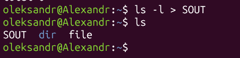

# Стандартные потоки, перенаправления и конвейеры

[← Оглавление](../../README.md) · [Справочник команд](commands-and-examples.md)

## stdin, stdout и stderr

У процесса обычно есть три стандартных потока:

| Поток | Номер | Назначение | В интерактивном терминале по умолчанию |
| --- | --- | --- | --- |
| `stdin` | `0` | Стандартный ввод | Ввод из терминала |
| `stdout` | `1` | Стандартный вывод | Вывод в терминал |
| `stderr` | `2` | Диагностика и сообщения об ошибках | Вывод в терминал |

`stdout` — основной вывод программы; сообщения об ошибках обычно направляются в `stderr`. Поток `stdin` используют многие программы, включая `cat` и `less`.

## Операторы перенаправления

| Оператор | Что делает |
| --- | --- |
| `>` или `1>` | Записывает `stdout` в файл, перезаписывая его содержимое |
| `>>` или `1>>` | Добавляет `stdout` в конец файла |
| `2>` | Записывает `stderr` в файл, перезаписывая его содержимое |
| `2>>` | Добавляет `stderr` в конец файла |
| `<` или `0<` | Передаёт содержимое файла на `stdin` программы |

При перенаправлении вывода файл создаётся, если его ещё нет. В примерах ниже команды работают с файлами в текущем каталоге.

### Записать вывод в файл

```bash
ls -l > listing.txt
cat listing.txt
```

`ls` записывает список в `listing.txt`, а `cat` выводит содержимое этого файла. Если файл уже существовал, `>` заменит его содержимое.



### Добавить вывод в конец файла

```bash
pwd >> listing.txt
```

Текущий путь добавится в конец `listing.txt`, сохранив предыдущие записи.

### Разделить обычный вывод и ошибки

```bash
ls -l /etc/ /path-that-does-not-exist > listing.txt 2> errors.txt
```

Список из `/etc/` попадёт в `listing.txt`, а сообщение об отсутствующем пути — в `errors.txt`, если такого пути нет.

### Передать файл на стандартный ввод

```bash
cat < listing.txt
```

Bash открывает файл и подключает его к `stdin` команды `cat`. В этом случае результат похож на `cat listing.txt`, но способ передачи данных отличается.

## Конвейер: оператор |

**Конвейер (pipe)** соединяет `stdout` команды слева со `stdin` команды справа:

```bash
ls -l /etc/ | less
```

```text
ls -l /etc/ → stdout → stdin → less
```

`ls` формирует список, а `less` позволяет его просматривать и прокручивать. Команды могут работать одновременно: `less` получает данные по мере их поступления. Для выхода нажми `q`.

Обычный оператор `|` передаёт только `stdout`; `stderr` остаётся отдельным потоком.

Подробнее о командах: [`cat`](commands-and-examples.md#cat), [`less`](commands-and-examples.md#less), [`ls`](commands-and-examples.md#ls).
