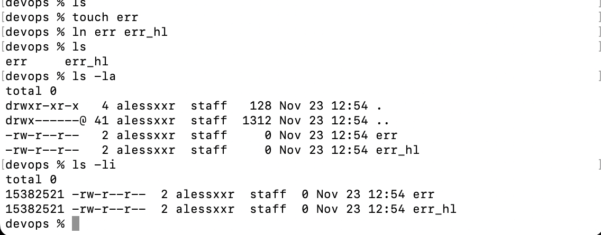

# Пользователи, группы и права доступа к файлам

[← Оглавление](../../README.md) · [Справочник команд](../2-working-in-terminal-and-commands/commands-and-examples.md)

## Пользователи и UID

Linux — многопользовательская система: у разных пользователей могут быть разные права доступа к файлам, каталогам и другим ресурсам.

Система различает пользователей по числовому идентификатору **UID** (_user identifier_). Имя пользователя — удобное для человека представление учётной записи.

| Учётная запись         | Назначение                                                                      |
| ---------------------- | ------------------------------------------------------------------------------- |
| `root`                 | Суперпользователь с UID `0`, обладающий широкими административными полномочиями |
| Обычный пользователь   | Повседневная работа с правами своей учётной записи                              |
| Системный пользователь | Запуск служб и процессов, например веб-сервера                                  |

Системным пользователям обычно выделяют отдельный диапазон UID. Граница `1000` встречается во многих дистрибутивах, но точные диапазоны зависят от настроек системы. Нельзя определять назначение любой учётной записи только по правилу «UID меньше 1000».

## Группы и GID

**Группа** объединяет пользователей для совместного доступа к ресурсам. Её числовой идентификатор — **GID** (_group identifier_).

У учётной записи есть **основная группа** (_primary group_), а также могут быть **дополнительные группы**. Пользователь может состоять сразу в нескольких группах.

## Просмотр пользователя и групп: id

```bash
id
```

Без аргумента `id` показывает идентификаторы и группы текущего пользователя. Чтобы посмотреть другую учётную запись, укажи её имя:

```bash
id root
id oleksandr
```

Пользователь из аргумента должен существовать в системе. В выводе `uid` — идентификатор пользователя, `gid` — основной группы, `groups` — список групп.

Подробнее об опциях: [`id` в справочнике](../2-working-in-terminal-and-commands/commands-and-examples.md#id).

## Владелец и группа файла

У каждого файла и каталога есть **владелец** и **группа**. Владельцем нового файла обычно становится создавший его пользователь; владельца и группу впоследствии можно изменить.

Посмотреть эти сведения вместе с правами доступа можно так:

```bash
ls -la
```


На скриншоте у `.bash_history` владелец — `oleksandr`, группа файла — тоже `oleksandr`. Это два отдельных поля, даже если их имена совпадают.

Групповые права относятся к **группе файла**. Она может отличаться от основной группы владельца.

## Три категории доступа

В базовой модели прав Linux выделяют три категории:

| Категория            | К кому относится                                                               |
| -------------------- | ------------------------------------------------------------------------------ |
| Владелец (_user_)    | Пользователь, которому принадлежит файл                                        |
| Группа (_group_)     | Пользователи, входящие в группу файла, в том числе через дополнительные группы |
| Остальные (_others_) | Пользователи, не являющиеся владельцем и не входящие в группу файла            |

При обычной проверке выбирается одна соответствующая категория: сначала владелец, затем группа, затем остальные. Права разных категорий не складываются.

## Чтение, запись и исполнение: r, w, x

Значение права зависит от того, применяется оно к файлу или каталогу:

| Право                        | Для обычного файла                | Для каталога                                                               |
| ---------------------------- | --------------------------------- | -------------------------------------------------------------------------- |
| `r` — чтение (_read_)        | Читать содержимое                 | Получать список имён внутри                                                |
| `w` — запись (_write_)       | Изменять содержимое               | Создавать, удалять и переименовывать записи; обычно требуется также `x`    |
| `x` — исполнение (_execute_) | Запускать файл как программу      | Проходить через каталог и обращаться к объектам внутри по известным именам |
| `-`                          | Соответствующее право отсутствует | Соответствующее право отсутствует                                          |

Право `x` на каталоге необходимо, в частности, для перехода в него через `cd`. Удаление файла определяется прежде всего правами на содержащий его каталог, а не правом записи в сам файл.

## Как читать строку прав

Пример из подробного вывода `ls`:

```text
d  rwx  r-x  r-x
│   │    │    └── остальные
│   │    └─────── группа
│   └──────────── владелец
└──────────────── тип объекта
```

Первый символ обозначает тип объекта: `d` — каталог, `-` — обычный файл. Следующие девять символов разбиты на три тройки: **владелец → группа → остальные**.

В этом примере владелец может читать список имён, изменять записи каталога и проходить через него; группа и остальные могут читать список имён и проходить через каталог.

Для сравнения, у `.bash_history` на скриншоте права `-rw-------`: это обычный файл, владелец может читать и изменять его, а для группы и остальных все три базовых права отсутствуют.

## Имена файлов и inode

Каталог хранит записи, которые связывают имена файлов и подкаталогов с их **inode**. В inode хранятся метаданные объекта, например его тип, владелец и права доступа.

Номер inode уникален **в пределах одной файловой системы**. На одном диске может быть несколько файловых систем, и номера inode в них могут совпадать. Команда `ls -i` показывает номер inode рядом с именем, а `ls -li` добавляет сведения о правах, владельце и числе жёстких ссылок.

## Жёсткие ссылки

**Жёсткая ссылка** (_hard link_) — имя, по которому можно обратиться к тому же файлу. Создай тестовый файл и добавь второе имя командой `ln`:

```bash
touch err
ln err err_hl
ls -li err err_hl
```



У `err` и `err_hl` совпадает номер inode в первом столбце. Число `2` после строки прав показывает, что у файла два имени. Изменения содержимого через любое из них видны через оба.

Жёсткую ссылку можно создать в другом каталоге той же файловой системы. Если удалить имя `err`, файл останется доступен как `err_hl`. Место освободится после удаления последней ссылки и закрытия файла всеми процессами.

## Символические ссылки

**Символическая ссылка** (_symbolic link_, или _soft link_) хранит путь к файлу или каталогу. Когда программа обращается по имени ссылки, система переходит по этому пути.

```bash
ln -s err err_sl
ls -l err_sl
```

Первый символ `l` в выводе обозначает символическую ссылку. Стрелка в записи `err_sl -> err` показывает сохранённый путь. Здесь путь относительный и отсчитывается от каталога, в котором лежит `err_sl`.

| Свойство                              | Жёсткая ссылка                       | Символическая ссылка                                       |
| ------------------------------------- | ------------------------------------ | ---------------------------------------------------------- |
| На что указывает                      | На тот же inode                      | На путь к цели                                             |
| Что произойдёт после удаления `err`   | Файл останется доступен как `err_hl` | `err_sl` перестанет работать, пока по пути `err` нет файла |
| Может вести в другую файловую систему | Нет                                  | Да                                                         |

## SUID и команды для работы с учётными записями

**SUID** (_set user ID_) — специальный бит прав. При запуске исполняемого файла с этим битом Linux при обычных условиях устанавливает эффективный UID процесса равным UID владельца файла.

| Команда           | Что делает                                                                                     |
| ----------------- | ---------------------------------------------------------------------------------------------- |
| `stat файл`       | Показывает метаданные файла или каталога, в том числе права, владельца и номер inode           |
| `su пользователь` | Запускает оболочку от имени указанного пользователя. Без имени целевая учётная запись — `root` |
| `usermod`         | Меняет параметры существующей учётной записи, например список дополнительных групп             |

## Где хранятся сведения о пользователях и группах

Основные файлы локальных учётных записей:

| Файл | Что содержит |
| --- | --- |
| `/etc/passwd` | Имена пользователей, UID, основной GID, домашние каталоги и оболочки входа |
| `/etc/group` | Имена групп, GID и списки участников |
| `/etc/shadow` | Данные для проверки паролей, включая хеши, и параметры срока действия паролей |

Это файлы локальной базы: система также может получать сведения об учётных записях из внешних служб.

### Формат /etc/passwd

Каждая строка описывает одну учётную запись и содержит семь полей, разделённых двоеточиями:

```text
имя:поле_пароля:UID:GID:комментарий:домашний_каталог:оболочка
```

Пример:

```text
student:x:1000:1000:Student:/home/student:/bin/bash
```

Здесь `1000` — UID пользователя и GID его основной группы, `/home/student` — домашний каталог, `/bin/bash` — оболочка входа. Значение `x` означает, что данные пароля находятся в `/etc/shadow`. Это UID, а не UUID.

### Формат /etc/group

```text
имя_группы:поле_пароля:GID:список_пользователей
```

Пример:

```text
developers:x:1001:student,oleksandr
```

Группа `developers` имеет GID `1001`; в списке явно указаны `student` и `oleksandr`. Пользователь также принадлежит своей основной группе по GID из `/etc/passwd`, даже если его имени нет в списке участников этой группы в `/etc/group`.

### Особенности /etc/shadow

Пароли не хранятся здесь в открытом виде: поле пароля может содержать хеш или служебный маркер, например признак блокировки парольного входа. Остальные поля задают параметры смены и срока действия пароля, а также срока действия учётной записи. Доступ к чтению `/etc/shadow` ограничен.

Форматы описаны в руководствах [passwd(5)](https://man7.org/linux/man-pages/man5/passwd.5.html), [group(5)](https://man7.org/linux/man-pages/man5/group.5.html) и [shadow(5)](https://man7.org/linux/man-pages/man5/shadow.5.html).

## Аутентификация и авторизация

- **Аутентификация** — проверка того, что пользователь является тем, за кого себя выдаёт, например по паролю или ключу. Одного существования учётной записи для этого недостаточно.
- **Авторизация** — проверка, разрешено ли пользователю выполнить конкретное действие.

Например, успешный вход подтверждает личность пользователя, но для изменения файла ему ещё нужны соответствующие права.

## Изменение прав: chmod

**`chmod`** (*change mode*) меняет права доступа к файлу или каталогу. Обычно это может делать владелец объекта или привилегированный пользователь.

### Символьная запись

```text
chmod категория_операция_права путь
```

| Категория | Для кого меняются права |
| --- | --- |
| `u` — user | Владелец файла |
| `g` — group | Группа файла |
| `o` — others | Остальные пользователи |
| `a` — all | Все три категории |

Оператор `+` добавляет права, `-` убирает, `=` задаёт указанный набор вместо прежнего для выбранной категории.

| Команда | Что делает |
| --- | --- |
| `chmod o-r err` | Убирает чтение у остальных |
| `chmod u-w err` | Убирает запись у владельца файла |
| `chmod u+w err` | Добавляет запись владельцу файла |
| `chmod g+r err` | Добавляет чтение группе файла |
| `chmod u=rw,g=r,o= err` | Задаёт владельцу чтение и запись, группе — чтение, остальным — никаких прав |

В этих примерах файл `err` должен существовать. Буква `u` обозначает владельца файла, который может отличаться от пользователя, запускающего команду.

## Числовые права

Для обычных прав используется трёхзначная восьмеричная запись. Каждая цифра — сумма значений прав одной категории:

| Право | Значение |
| --- | --- |
| `r` | `4` |
| `w` | `2` |
| `x` | `1` |
| Нет прав | `0` |

Например, `rw-` — это `4 + 2 = 6`, `r-x` — `4 + 1 = 5`, `rwx` — `4 + 2 + 1 = 7`. Порядок цифр: **владелец → группа → остальные**.

| Режим | Права | Значение |
| --- | --- | --- |
| `600` | `rw-------` | Чтение и запись только для владельца |
| `640` | `rw-r-----` | Владелец читает и пишет, группа читает, остальные без прав |
| `644` | `rw-r--r--` | Владелец читает и пишет, остальные читают |
| `755` | `rwxr-xr-x` | Владелец имеет все три права, группа и остальные — чтение и исполнение/проход |

```bash
chmod 640 err
ls -l err
```

Ожидаемые обычные права файла после этой команды — `rw-r-----`. Для каталога смысл `r`, `w` и `x` остаётся таким, как описано выше: например, без `x` нельзя перейти в каталог через `cd`.
