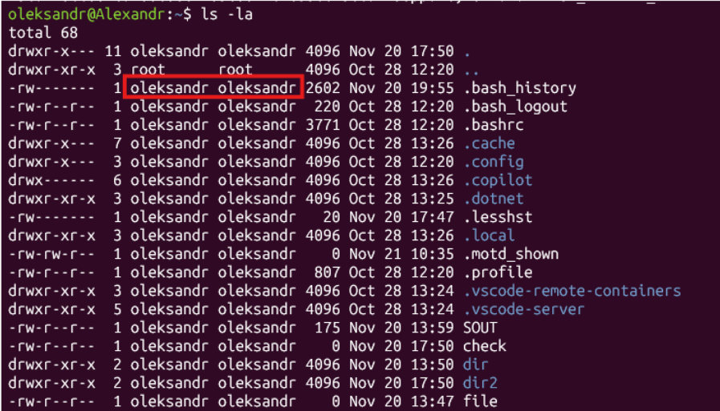

# Пользователи, группы и права доступа к файлам

[← Оглавление](../../README.md) · [Справочник команд](../2-working-in-terminal-and-commands/commands-and-examples.md)

## Пользователи и UID

Linux — многопользовательская система: у разных пользователей могут быть разные права доступа к файлам, каталогам и другим ресурсам.

Система различает пользователей по числовому идентификатору **UID** (*user identifier*). Имя пользователя — удобное для человека представление учётной записи.

| Учётная запись | Назначение |
| --- | --- |
| `root` | Суперпользователь с UID `0`, обладающий широкими административными полномочиями |
| Обычный пользователь | Повседневная работа с правами своей учётной записи |
| Системный пользователь | Запуск служб и процессов, например веб-сервера |

Системным пользователям обычно выделяют отдельный диапазон UID. Граница `1000` встречается во многих дистрибутивах, но точные диапазоны зависят от настроек системы. Нельзя определять назначение любой учётной записи только по правилу «UID меньше 1000».

## Группы и GID

**Группа** объединяет пользователей для совместного доступа к ресурсам. Её числовой идентификатор — **GID** (*group identifier*).

У учётной записи есть **основная группа** (*primary group*), а также могут быть **дополнительные группы**. Пользователь может состоять сразу в нескольких группах.

## Просмотр пользователя и групп: id

```bash
id
```

Без аргумента `id` показывает идентификаторы и группы текущего пользователя. Чтобы посмотреть другую учётную запись, укажи её имя:

```bash
id root
id oleksandr
```

Пользователь из аргумента должен существовать в системе. В выводе `uid` — идентификатор пользователя, `gid` — основной группы, `groups` — список групп.

Подробнее об опциях: [`id` в справочнике](../2-working-in-terminal-and-commands/commands-and-examples.md#id).

## Владелец и группа файла

У каждого файла и каталога есть **владелец** и **группа**. Владельцем нового файла обычно становится создавший его пользователь; владельца и группу впоследствии можно изменить.

Посмотреть эти сведения вместе с правами доступа можно так:

```bash
ls -la
```



На скриншоте у `.bash_history` владелец — `oleksandr`, группа файла — тоже `oleksandr`. Это два отдельных поля, даже если их имена совпадают.

Групповые права относятся к **группе файла**. Она может отличаться от основной группы владельца.

## Три категории доступа

В базовой модели прав Linux выделяют три категории:

| Категория | К кому относится |
| --- | --- |
| Владелец (*user*) | Пользователь, которому принадлежит файл |
| Группа (*group*) | Пользователи, входящие в группу файла, в том числе через дополнительные группы |
| Остальные (*others*) | Пользователи, не являющиеся владельцем и не входящие в группу файла |

При обычной проверке выбирается одна соответствующая категория: сначала владелец, затем группа, затем остальные. Права разных категорий не складываются.

## Чтение, запись и исполнение: r, w, x

Значение права зависит от того, применяется оно к файлу или каталогу:

| Право | Для обычного файла | Для каталога |
| --- | --- | --- |
| `r` — чтение (*read*) | Читать содержимое | Получать список имён внутри |
| `w` — запись (*write*) | Изменять содержимое | Создавать, удалять и переименовывать записи; обычно требуется также `x` |
| `x` — исполнение (*execute*) | Запускать файл как программу | Проходить через каталог и обращаться к объектам внутри по известным именам |
| `-` | Соответствующее право отсутствует | Соответствующее право отсутствует |

Право `x` на каталоге необходимо, в частности, для перехода в него через `cd`. Удаление файла определяется прежде всего правами на содержащий его каталог, а не правом записи в сам файл.

## Как читать строку прав

Пример из подробного вывода `ls`:

```text
d  rwx  r-x  r-x
│   │    │    └── остальные
│   │    └─────── группа
│   └──────────── владелец
└──────────────── тип объекта
```

Первый символ обозначает тип объекта: `d` — каталог, `-` — обычный файл. Следующие девять символов разбиты на три тройки: **владелец → группа → остальные**.

В этом примере владелец может читать список имён, изменять записи каталога и проходить через него; группа и остальные могут читать список имён и проходить через каталог.

Для сравнения, у `.bash_history` на скриншоте права `-rw-------`: это обычный файл, владелец может читать и изменять его, а для группы и остальных все три базовых права отсутствуют.
