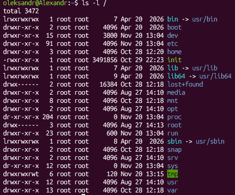
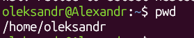

# Файловая система: каталоги, пути и имена файлов

[← Оглавление](../../README.md) · [Справочник команд](../2-working-in-terminal-and-commands/commands-and-examples.md)

## Принцип «всё — файл»

В Linux многие ресурсы представлены через файловый интерфейс: обычные файлы, каталоги, устройства и другие объекты. Это позволяет работать с ними единообразно.

## Корневой каталог

Файловая система Linux имеет древовидную структуру. Её начало — **корневой каталог `/`**.

Назначение основных каталогов в `/` следует общепринятой структуре. Набор каталогов и некоторые детали могут различаться между дистрибутивами.

## Текущий рабочий каталог

**Текущий рабочий каталог** — каталог, относительно которого программа разрешает относительные пути. Посмотреть его можно командой [`pwd`](../2-working-in-terminal-and-commands/commands-and-examples.md#pwd), перейти в другой — командой [`cd`](../2-working-in-terminal-and-commands/commands-and-examples.md#cd).

## Абсолютные и относительные пути

| Вид пути | Откуда отсчитывается | Примеры |
| --- | --- | --- |
| Абсолютный | От корневого каталога `/` | `/home/oleksandr`, `/etc` |
| Относительный | От текущего рабочего каталога | `notes`, `./notes`, `../notes` |

**Абсолютный путь** начинается с `/` и не зависит от текущего каталога. **Относительный путь** не начинается с `/`.

Полезные обозначения:

- `.` — текущий каталог.
- `..` — родительский каталог.
- `~` — обозначение домашнего каталога, которое Bash раскрывает, например, в `cd ~`.

Система трактует `.` и `..` как специальные компоненты пути. В корневом каталоге `/` путь `..` тоже ведёт к корню.

Если текущий каталог — `/home/oleksandr`, пути `notes` и `./notes` указывают на `/home/oleksandr/notes`, а `../notes` — на `/home/notes`.

## Имена файлов

- В типичных файловых системах Linux имена **регистрозависимы**: `notes.txt` и `Notes.txt` — разные имена.
- Ограничение длины имени зависит от файловой системы и обычно задаётся в **байтах**, а не в символах.
- В имени нельзя использовать `/` и нулевой символ (`NUL`). Символ `/` разделяет части пути.
- Для удобства лучше использовать понятные имена без лишних пробелов и специальных символов.

Если в пути есть пробелы, заключай его в кавычки: `cat "lecture notes.txt"`.

## Скрытые файлы и каталоги

**Скрытый файл или каталог** — тот, чьё имя начинается с точки. Например: `.bashrc` или `.config`.

Чтобы увидеть скрытые имена, используй [`ls -a`](../2-working-in-terminal-and-commands/commands-and-examples.md#ls).
