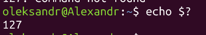
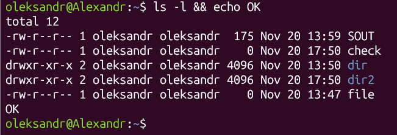
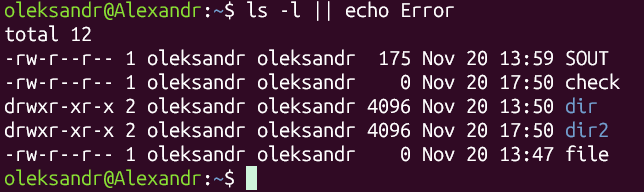
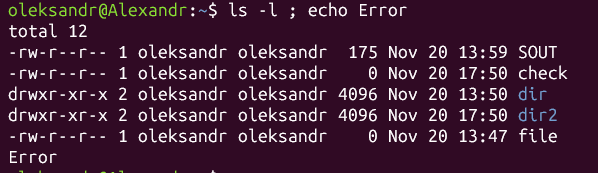
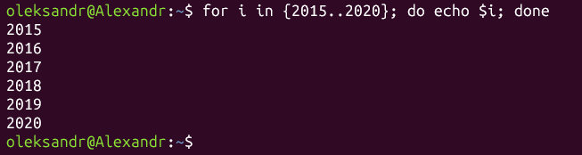

# Программирование на Bash: первые скрипты

[← Оглавление](../../README.md) · [Справочник команд](../2-working-in-terminal-and-commands/commands-and-examples.md)

## Коды возврата и $?

**Код возврата** (*exit status*) — число, по которому оболочка и другие программы определяют результат выполнения команды.

| Код | Значение |
| --- | --- |
| `0` | Успешное выполнение |
| Ненулевой | Неуспех или особый результат, зависящий от команды |
| `126` | Bash нашёл команду, но не смог её выполнить |
| `127` | Bash не нашёл команду |

Ненулевой код не всегда означает поломку: например, `grep` возвращает `1`, если совпадений нет.

Специальный параметр **`$?`** содержит код последней выполненной команды:

```bash
true
echo "$?"
false
echo "$?"
```

Первая проверка покажет `0`, вторая — `1`. Команды `true` и `false` возвращают эти коды и сами ничего не печатают. Это правило проверки успешности команд, а не универсальное представление всех логических значений в Bash.



Проверяй `$?` сразу после нужной команды: следующая команда заменит это значение. Если результат понадобится позже, сохрани его в переменную:

```bash
ls -l .
status=$?
echo "Код возврата ls: $status"
```

## Последовательности команд: &&, || и ;

| Запись | Когда выполняется вторая команда |
| --- | --- |
| `команда1 && команда2` | Если первая завершилась с кодом `0` |
| `команда1 \|\| команда2` | Если первая завершилась с ненулевым кодом |
| `команда1 ; команда2` | После завершения первой, независимо от её кода возврата |

Примеры с предсказуемым результатом:

```bash
true && echo "Успех"
false || echo "Неуспех"
false; echo "Эта команда тоже выполнится"
```

### Выполнить при успехе: &&

```bash
ls -l && echo "OK"
```



### Выполнить при неуспехе: ||

```bash
ls -l || echo "Error"
```

На скриншоте `ls` завершился успешно, поэтому `echo` не выполнился:



### Выполнить последовательно: ;

```bash
ls -l; echo "Error"
```

Здесь слово `Error` появится даже при успешном `ls`: это текст, который выводит `echo`, а не проверка ошибки.



## Переменные оболочки и окружения

### Присваивание и чтение

```bash
course="DevOps Linux"
echo "$course"
```

- При присваивании `$` не ставится: имя переменной — `course`, а `$course` — обращение к значению.
- Вокруг `=` не должно быть пробелов.
- Имя обычной переменной состоит из букв, цифр и `_`, но не начинается с цифры.
- Двойные кавычки в `"$course"` сохраняют значение с пробелами как один аргумент.
- Одинарные кавычки отключают подстановку: `echo '$course'` выведет буквально `$course`.

### Передача переменной дочерним программам

Переменная оболочки доступна в текущей оболочке. Чтобы передавать её запускаемым программам через **окружение**, используй `export`:

```bash
export PROJECT="devops-course"
bash -c 'echo "$PROJECT"'
```

Дочерний Bash получит `PROJECT` из окружения и выведет `devops-course`. Изменения в дочерней оболочке не меняют переменные родительской.

`env` без аргументов выводит **переменные окружения**, а не все переменные текущего Bash. Например, `PATH` задаёт каталоги, в которых оболочка ищет внешние команды.

## Цикл for

**Цикл `for`** выполняет набор команд для каждого элемента списка:

```bash
for year in {2015..2020}; do
    echo "$year"
done
```

Bash раскрывает `{2015..2020}` в список чисел. На каждой итерации переменная `year` получает следующее значение; тело цикла находится между `do` и `done`.

Однострочная запись из лекции:

```bash
for i in {2015..2020}; do echo "$i"; done
```



## Скрипты и shebang

**Скрипт** — текстовый файл с командами для интерпретатора. В [test.sh](test.sh) находится пример цикла из этой лекции.

Первая строка **`#!/bin/bash`** называется *shebang*: при прямом запуске исполняемого файла она указывает системе использовать интерпретатор `/bin/bash`.

Из каталога `5-bash` файл можно запустить двумя способами:

```bash
bash test.sh
```

Так Bash получает файл явно; право исполнения у самого файла не требуется, но он должен быть доступен для чтения.

```bash
chmod u+x test.sh
./test.sh
```

Для прямого запуска требуется право исполнения. Префикс `./` указывает на файл в текущем каталоге. Скрипт выведет шесть строк от `Год: 2015` до `Год: 2020`.

Проверить синтаксис без выполнения команд:

```bash
bash -n test.sh
```

Для Linux сохраняй скрипты с переводами строк **LF**: Windows-переводы CRLF могут мешать обработке shebang и команд.

## Как найти команду

| Команда | Что показывает |
| --- | --- |
| `type bash` | Как Bash интерпретирует имя `bash`, обычно — путь к исполняемому файлу |
| `type cd` | Что `cd` является встроенной командой оболочки |
| `type -a bash` | Все найденные варианты команды |
| `whereis ls` | Найденные пути к бинарному файлу, исходникам и страницам руководства `ls` |

`whereis` может вывести несколько путей и не определяет, какой псевдоним или функцию использует оболочка. Для проверки того, как Bash понимает имя команды, используй `type`.

## Файлы настройки Bash

Переменные не обязаны создаваться в одном файле: Bash наследует окружение при запуске, а новые значения можно задавать в терминале, скриптах и файлах настройки.

Какие файлы читаются, зависит от режима запуска Bash:

| Режим | Файлы |
| --- | --- |
| Оболочка входа (*login shell*) | `/etc/profile`, затем первый доступный для чтения из `~/.bash_profile`, `~/.bash_login`, `~/.profile` — именно в таком порядке |
| Интерактивная оболочка без входа | `~/.bashrc`; дополнительные системные настройки зависят от дистрибутива |

`/etc/profile` — **файл**, а `~/.profile` находится в домашнем каталоге пользователя. Файлы login shell не читаются автоматически при каждом запуске терминала. Часто пользовательский login-файл сам подключает `~/.bashrc`.

Обычный запуск `bash test.sh` не читает эти интерактивные настройки автоматически, поэтому скриптам не стоит полагаться на псевдонимы из `.bashrc`.

Подробнее: [Bash Reference Manual — Exit Status](https://tiswww.case.edu/php/chet/bash/bashref.html#Exit-Status) и [Bash Startup Files](https://tiswww.case.edu/php/chet/bash/bashref.html#Bash-Startup-Files).
