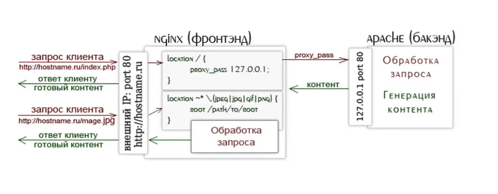
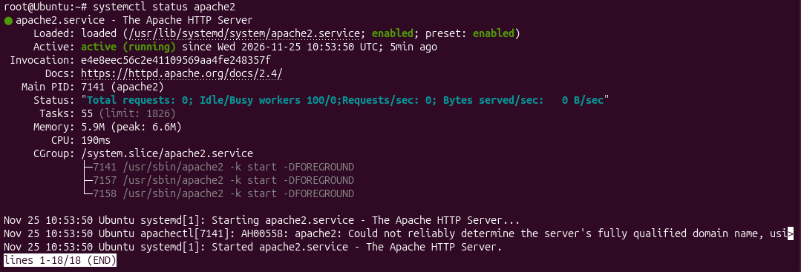
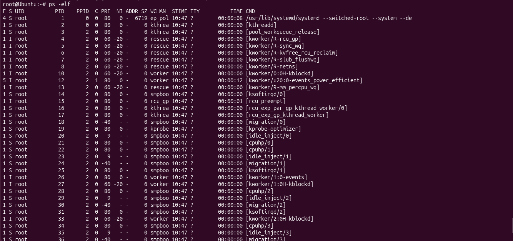
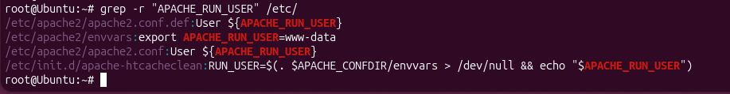
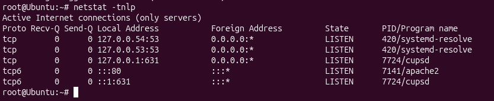
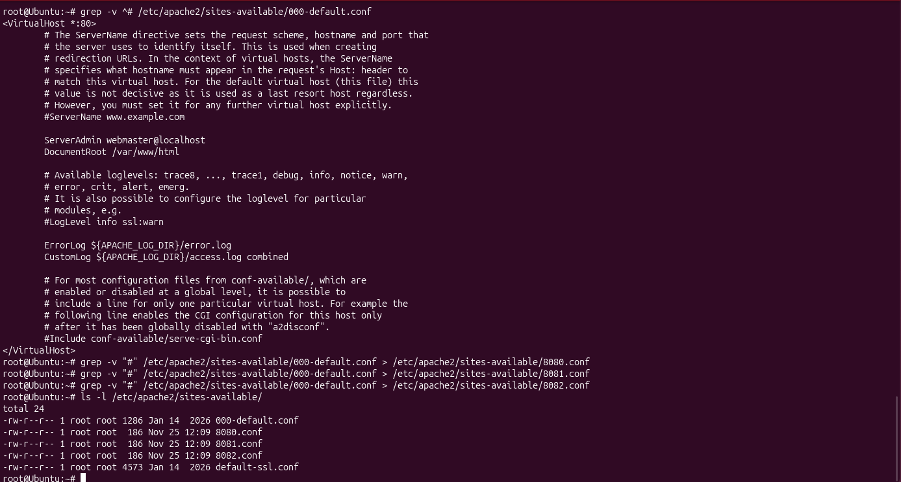
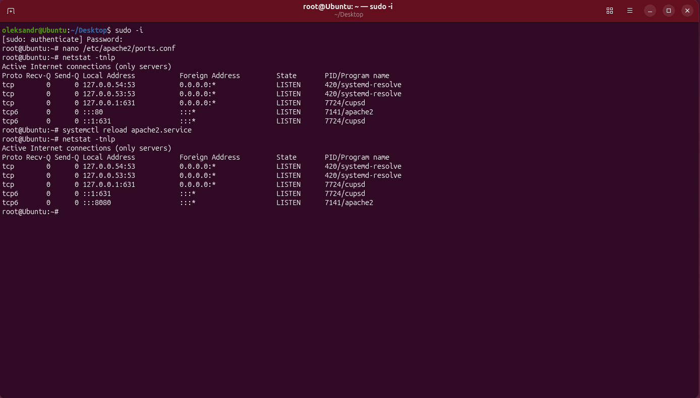
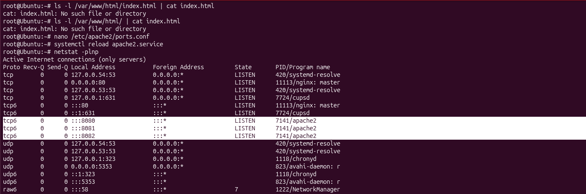
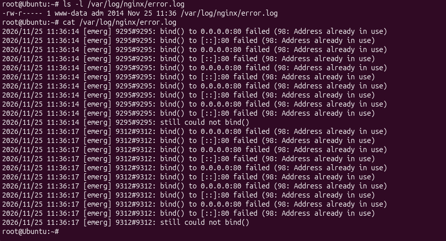

# Веб-сервисы: Apache, Nginx, службы и DNS

[← Оглавление](../../README.md) · [Справочник команд](../2-working-in-terminal-and-commands/commands-and-examples.md)

Пути и команды ниже ориентированы на **Debian/Ubuntu с systemd**, как в лекции. В других дистрибутивах имена служб и расположение конфигурации могут отличаться. Команды установки и управления службами — примеры для учебной Linux-машины.

## HTTP и веб-сервер

**Веб-сервер** принимает HTTP-запросы и возвращает ответы: HTML, изображения, JSON и другие данные. **HTTPS** защищает обмен HTTP с помощью TLS. Обычные порты — `80` для HTTP и `443` для HTTPS.

Упрощённая последовательность:

```text
Имя сайта → определение IP-адреса → соединение с сервером → HTTP-запрос → HTTP-ответ
```

- **Статический контент** — готовые файлы, которые сервер отдаёт клиенту.
- **Динамический контент** — результат работы приложения, например HTML, сформированный с учётом пользователя или запроса к базе данных.

Наличие HTML само по себе не делает страницу динамической: готовый `index.html` может быть обычным статическим файлом.

## Apache и Nginx

| Сервер | Основные особенности |
| --- | --- |
| **Apache HTTP Server** | Отдаёт файлы, поддерживает модули, виртуальные хосты и проксирование к приложениям |
| **Nginx** | Отдаёт файлы, работает как обратный прокси, поддерживает несколько сайтов и использует событийную модель обработки соединений |

Apache обрабатывает несколько запросов параллельно с помощью процессов и/или потоков; конкретная модель зависит от MPM. Он может напрямую обслуживать клиентов. Утверждение, что Apache всегда ждёт завершения одного клиента перед переходом к следующему, неверно. Подробнее: [модули MPM Apache](https://httpd.apache.org/docs/2.4/mpm.html).

Nginx также может обслуживать несколько доменов. Динамические запросы он часто передаёт приложению или другому серверу. Подробнее: [руководство Nginx](https://nginx.org/en/docs/beginners_guide.html).

### Виртуальный хостинг

**Виртуальный хостинг** позволяет обслуживать несколько сайтов одним экземпляром веб-сервера. Разные домены могут указывать на один IP-адрес.

Для Apache используются блоки `<VirtualHost>` с `ServerName` и при необходимости `ServerAlias`; для Nginx — блоки `server` с `server_name`. Сервер выбирает сайт с учётом адреса, порта и запрошенного имени; в HTTP/1.1 имя передаётся в заголовке `Host`.

Одной DNS-записи недостаточно: веб-сервер тоже должен быть настроен на нужное имя. См. [виртуальные хосты Apache](https://httpd.apache.org/docs/2.4/vhosts/name-based.html).

### .htaccess в Apache

**`.htaccess`** позволяет задавать часть настроек для каталога сайта и его подкаталогов. Допустимые директивы определяются настройками `AllowOverride` и `AllowOverrideList`; при запрете переопределений файл не применяется.

Если есть доступ к основной конфигурации, Apache рекомендует задавать настройки в ней. Подробнее: [.htaccess в документации Apache](https://httpd.apache.org/docs/2.4/howto/htaccess.html).

## Прямой и обратный прокси

**Прокси-сервер** — посредник, который принимает запрос и передаёт его дальше.

| Тип | Чью сторону представляет | Пример |
| --- | --- | --- |
| Прямой прокси (*forward proxy*) | Клиента | Корпоративный прокси, через который сотрудники обращаются к внешним сайтам |
| Обратный прокси (*reverse proxy*) | Серверную часть | Nginx принимает запросы к сайту и передаёт их Apache или приложению |

В связке из лекции Nginx выступает внешним сервером, а Apache — внутренним:

```text
Клиент → Nginx :80 → Apache 127.0.0.1:8080 → ответ через Nginx клиенту
```

Nginx может самостоятельно отдавать статику, а остальные запросы проксировать. Здесь слова «фронтенд» и «бэкенд» обозначают положение серверов в цепочке. Это не то же самое, что пользовательский интерфейс приложения.



Схема иллюстрирует архитектуру; готовую запись `proxy_pass` смотри в примере ниже.

## Установка пакетов: dpkg и APT

**Пакет** содержит устанавливаемые файлы и метаданные. **Репозиторий** — источник пакетов и их описаний. **Пакетный менеджер** выбирает пакеты и работает с зависимостями.

В Debian/Ubuntu `dpkg` управляет пакетами `.deb`, а APT загружает пакеты из настроенных источников и разрешает зависимости. Репозиторий сам не устанавливает зависимости.

| Команда | Назначение |
| --- | --- |
| `sudo apt-get update` | Обновить локальные списки доступных пакетов; установленные программы не обновляет |
| `apt-cache search apache2` | Найти пакеты по локальным метаданным репозиториев |
| `apt-cache search nginx` | Найти пакеты, связанные с Nginx |
| `sudo apt-get install apache2` | Установить Apache и необходимые зависимости |
| `sudo apt-get install nginx` | Установить Nginx и необходимые зависимости |
| `dpkg -l apache2 nginx` | Посмотреть записи о пакетах и их статус; `ii` означает установленный пакет |

Установка может автоматически запустить службу. Если Apache и Nginx оба пытаются занять порт `80` на одном адресе, один из них может не запуститься.

Подробнее: [управление пакетами Ubuntu](https://ubuntu.com/server/docs/how-to/software/package-management/).

## Управление службами через systemctl

**Служба** — приложение, которым управляет менеджер служб, например systemd.

| Команда | Назначение |
| --- | --- |
| `systemctl status apache2` | Посмотреть состояние Apache |
| `systemctl status nginx` | Посмотреть состояние Nginx |
| `sudo systemctl start apache2` | Запустить Apache |
| `sudo systemctl stop apache2` | Остановить Apache |
| `sudo systemctl reload apache2` | Перечитать конфигурацию работающего Apache |
| `sudo systemctl restart apache2` | Остановить и запустить Apache заново |

Для Nginx в командах управления используй имя службы `nginx`. `reload` применяется, если служба поддерживает перечитывание конфигурации.



`active (running)` означает, что служба работает сейчас. `enabled` относится к настройке её запуска, а не подтверждает текущее состояние. Для выхода из просмотра нажми `q`.

`systemctl daemon-reload` перечитывает определения служб systemd и не заменяет `reload` веб-сервера. См. [руководство systemctl](https://www.freedesktop.org/software/systemd/man/latest/systemctl.html).

## Процессы и пользователь службы

**Процесс** — выполняющийся экземпляр программы с PID, памятью и другими ресурсами. Несколько процессов могут относиться к одной службе.

```bash
ps -efl
```

Опция `-e` выбирает все процессы, `-f` включает полный формат, `-l` — дополнительные поля длинного формата. В выводе важны `UID`, `PID`, `PPID` и команда запуска.



У Apache может быть управляющий процесс с правами root и рабочие процессы под отдельным пользователем, например `www-data`. Права этого пользователя определяют доступ к файлам сайта.

В пакетной конфигурации Debian/Ubuntu значение можно найти так:

```bash
grep -n 'APACHE_RUN_USER' /etc/apache2/envvars
```



## Слушающие порты: ss и netstat

Посмотреть слушающие TCP-сокеты и связанные процессы:

```bash
sudo ss -tlnp
```

Вариант из лекции, если установлен пакет `net-tools`:

```bash
sudo netstat -tnlp
```

Значения опций: `-t` — TCP, `-l` — слушающие сокеты, `-n` — числовые адреса и порты, `-p` — сведения о процессе. Для полных сведений о чужих процессах могут требоваться административные права. См. [руководство ss](https://man7.org/linux/man-pages/man8/ss.8.html).



| Адрес | Как читать |
| --- | --- |
| `127.0.0.1:8080` | Порт доступен через IPv4 loopback на этой машине |
| `0.0.0.0:80` | Прослушиваются все локальные IPv4-адреса |
| `[::]:80` или `:::80` в netstat | Прослушиваются все локальные IPv6-адреса |

`tcp6` обозначает IPv6-сокет. Принимать ли через него также IPv4-соединения, зависит от настроек сокета и системы; по одной надписи `tcp6` этого не определить. См. [IPv6 в Linux](https://man7.org/linux/man-pages/man7/ipv6.7.html).

Наличие слушающего сокета ещё не гарантирует доступ извне: на соединение также влияют маршрутизация и межсетевой экран.

## Конфигурация сайтов и журналы

Типичные пути в пакетах Debian/Ubuntu:

| Путь | Назначение |
| --- | --- |
| `/etc/apache2/apache2.conf` | Основная конфигурация Apache |
| `/etc/apache2/ports.conf` | Директивы `Listen`: адреса и порты Apache |
| `/etc/apache2/sites-available/` | Доступные конфигурации виртуальных хостов Apache |
| `/etc/apache2/sites-enabled/` | Подключённые конфигурации, обычно символические ссылки |
| `/etc/nginx/nginx.conf` | Основная конфигурация Nginx |
| `/etc/nginx/sites-available/` | Конфигурации сайтов Nginx в этой пакетной схеме |
| `/etc/nginx/sites-enabled/` | Подключённые конфигурации сайтов Nginx |
| `/var/www/html/` | Каталог файлов сайта по умолчанию в учебной конфигурации |
| `/var/log/nginx/error.log` | Файл журнала ошибок Nginx |

Наличие файла в `sites-available` само по себе не подключает сайт. Файл должен попасть в конфигурацию, которую читает сервер. Для Apache в Debian/Ubuntu используется, например, `sudo a2ensite site.conf`; для Nginx в этой схеме — символическая ссылка в `sites-enabled`.

`IncludeOptional sites-enabled/*.conf` подключает дополнительные файлы Apache. Если подходящих файлов нет, директива допускает их отсутствие. Подробнее: [IncludeOptional](https://httpd.apache.org/docs/2.4/mod/core.html#includeoptional).

### DocumentRoot и стартовая страница

**`DocumentRoot` указывает на каталог**, например `/var/www/html`, а не на один HTML-файл. Стартовый файл для запроса каталога выбирает `DirectoryIndex`, например `index.html`. См. [настройки Apache в Ubuntu](https://ubuntu.com/server/docs/how-to/web-services/configure-apache2-settings/).

```bash
ls -l /var/www/html/
cat /var/www/html/index.html
```

Конструкция `ls -l /var/www/html/ | cat index.html` не читает содержимое перечисленных файлов: `cat` с аргументом пытается открыть `index.html` относительно текущего каталога.



При копировании конфигурации для другого порта согласуй `Listen` и адрес в `<VirtualHost>`. Одного имени файла `8080.conf` для изменения порта недостаточно.

## Пример связки Nginx → Apache

Ниже — фрагменты для одного учебного сайта `site.test`: внешний Nginx слушает `80`, Apache — только `127.0.0.1:8080`. Их нужно разместить в соответствующих активных конфигурациях; они не заменяют всю конфигурацию сервера.

### Apache: внутренний сервер

Для этой схемы в `/etc/apache2/ports.conf` вместо обычного `Listen 80` используется:

```apache
Listen 127.0.0.1:8080
```

Пример `/etc/apache2/sites-available/site.conf`:

```apache
<VirtualHost 127.0.0.1:8080>
    ServerName site.test
    DocumentRoot /var/www/html
</VirtualHost>
```

Каталог и стартовая страница должны существовать и быть доступны рабочему пользователю Apache. Активируй этот виртуальный хост; замени или отключи прежние конфигурации, которые он должен заменить.



На скриншотах лекции Apache также слушает `8081` и `8082`; для приведённого примера нужен только `8080`. В примере используется loopback, тогда как на скриншотах виден wildcard IPv6-адрес.

### Nginx: внешний обратный прокси

Пример блока `server` в `/etc/nginx/sites-available/site.conf`, подключённого через `sites-enabled`:

```nginx
server {
    listen 80;
    server_name site.test;

    location / {
        proxy_pass http://127.0.0.1:8080;
        proxy_set_header Host $host;
        proxy_set_header X-Real-IP $remote_addr;
    }
}
```

`proxy_pass` задаёт адрес внутреннего сервера. Заголовок `Host` передаётся Apache для выбора виртуального хоста. Подробнее: [модуль проксирования Nginx](https://nginx.org/en/docs/http/ngx_http_proxy_module.html#proxy_pass).

### Проверка и применение

Перед применением проверь синтаксис:

```bash
sudo apache2ctl configtest
sudo nginx -t
```

После успешной проверки перечитай конфигурацию работающих служб:

```bash
sudo systemctl reload apache2
sudo systemctl reload nginx
```

Если служба остановлена, сначала устрани причину, затем используй `start`. После изменения проверь состояние и порты:

```bash
systemctl status apache2 nginx
sudo ss -tlnp
```



HTTP-проверка внутреннего сервера и всей цепочки с нужным именем сайта:

```bash
curl -I -H 'Host: site.test' http://127.0.0.1:8080/
curl -I -H 'Host: site.test' http://127.0.0.1/
```

`curl -I` отправляет HEAD-запрос и показывает заголовки ответа. Для получения содержимого страницы убери `-I`. Локальная проверка не подтверждает доступность сервера с другой машины.

## Ошибка Address already in use

Если Nginx не запускается, проверь статус, слушающие порты и журнал:

```bash
systemctl status nginx
sudo ss -tlnp
sudo less /var/log/nginx/error.log
```



На скриншоте Nginx не смог привязаться к `80`: этот порт уже занят на соответствующем адресе. По списку сокетов определи владельца порта, затем согласуй конфигурацию. В учебной связке внешний порт получает Nginx, внутренний — Apache.

## Имена хостов и DNS

### /etc/hosts

**`/etc/hosts`** — локальная таблица соответствия имён и IP-адресов в Linux. Например, на машине, где запущены учебные серверы:

```text
127.0.0.1 site.test
```

Для обращения с другой машины указывается адрес сервера, а не её собственный `127.0.0.1`. Изменение `hosts` действует локально и не создаёт публичную DNS-запись. Порядок использования источников имён задаётся настройками системы. См. [hosts(5)](https://man7.org/linux/man-pages/man5/hosts.5.html).

### nslookup и системное разрешение имён

```bash
nslookup example.com
```

`nslookup` отправляет запрос DNS-серверу; это не прямая проверка локального `/etc/hosts`. Для проверки имени через системные источники можно использовать:

```bash
getent hosts site.test
```


На скриншоте `127.0.0.53` — DNS-сервер, которому отправлен запрос, а `127.0.0.1` и `::1` — адреса в ответе для `localhost`. Подробнее: [nslookup в руководстве BIND](https://bind9.readthedocs.io/en/latest/manpages.html#nslookup-query-internet-name-servers-interactively).

### /etc/resolv.conf

**`/etc/resolv.conf`** содержит настройки DNS-резолвера, в том числе строки `nameserver` с адресами DNS-серверов. См. [resolv.conf(5)](https://man7.org/linux/man-pages/man5/resolv.conf.5.html).

```bash
cat /etc/resolv.conf
```

В современных установках файл часто управляется сетевой службой и может быть символической ссылкой. При systemd-resolved адрес `127.0.0.53` обычно указывает на локальный резолвер; реальные вышестоящие DNS-серверы можно посмотреть через `resolvectl status`. Ручные изменения управляемого файла могут быть перезаписаны.
