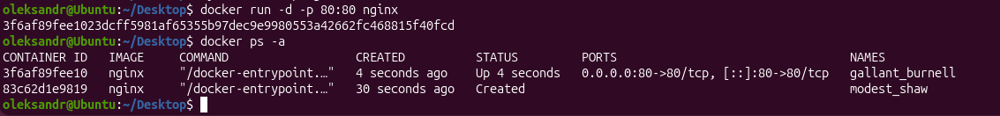
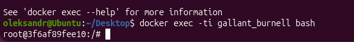

# Команды Docker: справочник с примерами

[← Оглавление](../../README.md) · [Теория: архитектура и контейнеры](theory.md)

Примеры рассчитаны на Linux-контейнеры и установленный, работающий Docker Engine или Docker Desktop. Команды требуют доступа к выбранному Docker daemon. Выполняй их на хосте, а не внутри контейнера.

В примерах контейнер называется **`web-demo`**, образ — **`nginx:stable`**, адрес учебного сайта — **`http://127.0.0.1:8088`**. Выбери другое имя или свободный порт, если они уже заняты. Для удалённого Docker daemon адрес относится к машине движка.

## Быстрый поиск

| Задача | Команда |
| --- | --- |
| Проверить клиент и подключение к движку | [docker version](#docker-version) |
| Найти образы на Docker Hub | [docker search](#docker-search) |
| Скачать образ | [docker pull](#docker-pull) |
| Посмотреть локальные образы | [docker image ls](#docker-image-ls) |
| Создать и запустить контейнер | [docker run](#docker-run) |
| Посмотреть контейнеры | [docker ps](#docker-ps) |
| Посмотреть вывод приложения | [docker logs](#docker-logs) |
| Выполнить команду внутри работающего контейнера | [docker exec](#docker-exec) |
| Остановить контейнер | [docker stop](#docker-stop) |
| Снова запустить существующий контейнер | [docker start](#docker-start) |
| Удалить контейнер | [docker rm](#docker-rm) |
| Удалить локальный образ | [docker image rm](#docker-image-rm) |
| Посмотреть подробные настройки контейнера | [docker inspect](#docker-inspect) |

Ниже — справочные примеры. В конце есть цельный сценарий, который можно пройти по порядку.

## docker version

```bash
docker version
```

Показывает сведения о клиенте и серверной части Docker. Если сведения о клиенте есть, а подключение к серверу завершается ошибкой, проверь запуск движка и доступ к нему.

## docker search

Ищет **образы на Docker Hub**, а не запущенные контейнеры:

```bash
docker search nginx
```

Не скачивает образ и не запускает контейнер. См. [документацию docker search](https://docs.docker.com/reference/cli/docker/search/).

## docker pull

Скачивает образ в локальное хранилище Docker:

```bash
docker pull nginx:stable
```

После скачивания контейнер ещё не создан. Слово «установка» здесь легко спутать с установкой Nginx в хостовую ОС: файлы образа управляются Docker отдельно.

## docker image ls

Показывает локальные образы:

```bash
docker image ls
```

Варианты `docker image list` и `docker images` также используются для этой задачи. Основные поля: имя репозитория, тег, ID и размер образа.

## docker run

Создаёт **новый контейнер** из образа и запускает его:

```bash
docker run --name web-demo -d -p 127.0.0.1:8088:80 nginx:stable
```

| Часть | Значение |
| --- | --- |
| `--name web-demo` | Назначить имя контейнера |
| `-d` | Запустить в фоне, не занимая терминал выводом приложения |
| `-p 127.0.0.1:8088:80` | Опубликовать порт контейнера `80` на IPv4 loopback хоста, порт `8088` |
| `nginx:stable` | Образ, из которого создаётся контейнер |

Если образа нет локально, при обычных настройках Docker скачает его. Повторный `run` создаёт новый контейнер; для уже существующего имени используй `start` или выбери другое имя.

### Как читать публикацию порта

```text
-p [IP_ХОСТА:]ПОРТ_ХОСТА:ПОРТ_КОНТЕЙНЕРА
```

Для примера выше путь запроса выглядит так:

```text
http://127.0.0.1:8088 → порт 8088 хоста → порт 80 контейнера → Nginx
```

Запись из лекции `-p 80:80` использует одинаковые номера портов, но они не обязаны совпадать. Без IP в обычной настройке Docker порт публикуется на всех адресах хоста. Для локальной учебной проверки здесь явно указан `127.0.0.1`. См. [публикацию портов Docker](https://docs.docker.com/engine/network/port-publishing/).



На скриншоте у одного контейнера статус `Up`, у другого — `Created`: второй создан, но не работает. Отсутствие опубликованного порта не означает отсутствие сети у контейнера.

## docker ps

```bash
docker ps
docker ps -a
```

Без `-a` показывает работающие контейнеры; с `-a` — также созданные и остановленные.

| Поле | Значение |
| --- | --- |
| `CONTAINER ID` | Идентификатор контейнера |
| `IMAGE` | Образ, использованный при создании |
| `STATUS` | Состояние: например, `Up`, `Created`, `Exited` |
| `PORTS` | Сведения о портах, включая публикацию на хосте |
| `NAMES` | Имя контейнера |

В командах можно использовать имя или достаточно длинный уникальный префикс ID.

## docker logs

Показывает стандартный вывод и ошибки основного приложения, доступные через настроенную систему логирования:

```bash
docker logs --tail 20 web-demo
```

Для просмотра новых записей по мере появления:

```bash
docker logs -f web-demo
```

`Ctrl+C` прекращает просмотр логов; контейнер продолжает работать. Команда не читает автоматически произвольный файл журнала внутри контейнера.

## docker exec

Запускает дополнительную команду в **работающем** контейнере. Требуются и имя контейнера, и команда:

```text
docker exec [опции] КОНТЕЙНЕР КОМАНДА [аргументы]
```

Открыть интерактивную оболочку:

```bash
docker exec -it web-demo sh
```

`-i` оставляет стандартный ввод открытым, `-t` выделяет псевдотерминал. Порядок `-ti` из лекции тоже допустим. Оболочка `bash` есть не во всех образах; в учебном примере используется `sh`.



Для выхода введи внутри оболочки:

```sh
exit
```

Выход из дополнительной оболочки `exec` не завершает основной процесс Nginx. Команду можно выполнить и без интерактивного режима:

```bash
docker exec web-demo nginx -v
```

См. [документацию docker exec](https://docs.docker.com/reference/cli/docker/container/exec/).

## docker stop

Останавливает контейнер, сохраняя его для повторного запуска:

```bash
docker stop web-demo
```

После остановки контейнер виден в `docker ps -a`, а образ остаётся в локальном хранилище. В учебном примере не используется автоматическое удаление через `--rm`.

## docker start

Запускает уже существующий остановленный контейнер с прежними настройками:

```bash
docker start web-demo
```

Сохраняются имя, публикация порта и изменения записываемого слоя. Чтобы задать другие порты, обычно пересоздают контейнер с нужными параметрами.

## docker rm

Удаляет **контейнер**, а не образ. Обычный порядок для учебного контейнера:

```bash
docker stop web-demo
docker rm web-demo
```

Удаляется и записываемый слой этого контейнера. Образ `nginx:stable` остаётся; данные в отдельных томах управляются отдельно. См. [удаление контейнеров](https://docs.docker.com/reference/cli/docker/container/rm/).

## docker image rm

Удаляет локальный образ или указанную ссылку-тег на него:

```bash
docker image rm nginx:stable
```

Если на образ ссылаются контейнеры, удаление может быть отклонено. Сначала проверь и удали только ненужные контейнеры, включая остановленные. Команда не удаляет образ из Docker Hub. См. [docker image rm](https://docs.docker.com/reference/cli/docker/image/rm/).

## docker inspect

Показывает подробные настройки и состояние контейнера в JSON:

```bash
docker inspect web-demo
```

Обрати внимание на `State`, `Mounts` и `NetworkSettings`: состояние, подключения данных и сеть.

## Практический сценарий: Nginx на локальном порту 8088

Этот сценарий создаёт один учебный контейнер. Перед началом имя `web-demo` должно быть свободно.

### 1. Скачать образ и запустить сайт

```bash
docker pull nginx:stable
docker run --name web-demo -d -p 127.0.0.1:8088:80 nginx:stable
docker ps
```

### 2. Проверить HTTP-ответ и логи

```bash
curl -I http://127.0.0.1:8088/
docker logs --tail 20 web-demo
```

При успешном запуске Nginx отвечает по HTTP; проверка выполняется на машине, где опубликован порт. Через браузер можно открыть тот же адрес.

### 3. Выполнить команду внутри контейнера

```bash
docker exec web-demo nginx -v
```

Для интерактивной оболочки используй пример из раздела `docker exec` и выйди из неё перед продолжением.

### 4. Остановить и снова запустить тот же контейнер

```bash
docker stop web-demo
docker ps -a
docker start web-demo
curl -I http://127.0.0.1:8088/
```

**Проверка:** имя и ID контейнера остались прежними, сайт снова отвечает. См. также [запуск контейнеров в документации Docker](https://docs.docker.com/engine/containers/run/).

### 5. Удалить учебный контейнер

```bash
docker stop web-demo
docker rm web-demo
docker ps -a
docker image ls
```

**Проверка:** контейнера `web-demo` больше нет, образ `nginx:stable` остался. Удалять образ для завершения упражнения не требуется.

## Типичные ошибки

| Симптом | Что проверить |
| --- | --- |
| Нет подключения к Docker daemon | Запущен ли движок, выбран ли нужный контекст и есть ли доступ к нему |
| Имя контейнера уже используется | `docker ps -a`: существующий контейнер можно снова запустить или выбрать другое имя для нового |
| Порт занят | Другой контейнер, Apache или Nginx на хосте могли занять этот порт; выбери свободный порт хоста |
| Контейнер быстро перешёл в `Exited` | Посмотри `docker logs` и `docker inspect`, выясни причину завершения основного процесса |
| `docker exec` не работает | Контейнер должен быть запущен; после его имени нужно указать существующую внутри команду |
| Не найдена оболочка `bash` | Используй доступную в образе оболочку, например `sh`, либо выполняй нужную программу напрямую |
| Образ виден, но сайт не открывается | Наличие образа не означает работающий контейнер; проверь `docker ps`, порт публикации и HTTP-ответ |
