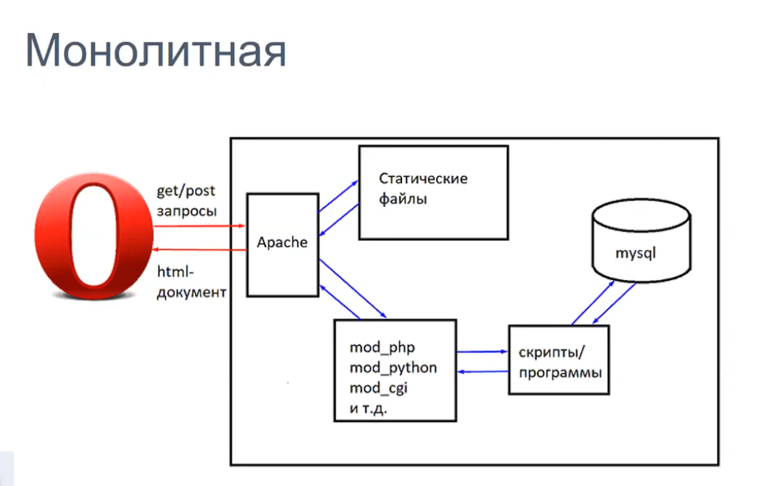

# Архитектура сервисов, виртуализация и Docker

[← Оглавление](../../README.md) · [Команды Docker и примеры](docker-commands-and-examples.md)

## Монолит и сервисная архитектура

**Монолит** — приложение, основные части которого разворачиваются как единое целое. Его модули могут отвечать за разные задачи: работу с пользователями, заказы, формирование страниц.

**SOA** (*service-oriented architecture*, сервисно-ориентированная архитектура) предполагает разделение системы на сервисы с определёнными обязанностями и интерфейсами взаимодействия. Например, веб-приложение может обращаться к отдельному сервису авторизации через API.

Архитектура приложения и размещение на серверах — разные вопросы: монолит можно запускать на нескольких машинах, а несколько сервисов — на одной. Правило «один сервер — один сервис» не определяет монолитную архитектуру.

На схеме показано совместное размещение компонентов веб-стека. Само по себе оно ещё не описывает границы приложения и его модулей.

## Виртуальные машины

- **Хост** — система, предоставляющая ресурсы для запуска виртуальных машин.
- **Гостевая система** — ОС внутри виртуальной машины.
- **Гипервизор** — слой виртуализации, который предоставляет гостевым системам виртуальное оборудование и управляет выделением ресурсов.

Виртуальная машина получает виртуальные CPU, память, диски и сетевые устройства. Внутри работает отдельная ОС со своим ядром. Выделять все ресурсы физического компьютера одной VM не требуется: на одном хосте могут работать несколько VM.

Гипервизор может работать непосредственно на оборудовании или поверх хостовой ОС. VM используют, например, для запуска разных ОС и разделения окружений на одном сервере.

## Контейнеры и изоляция в Linux

**Контейнер** — изолированное окружение для запуска процесса или группы процессов с необходимыми файлами и зависимостями. Это не просто каталог и не отдельная виртуальная машина.

Linux-контейнеры используют ядро системы, на которой они работают. Основные механизмы:

| Механизм | Назначение |
| --- | --- |
| **Namespaces** | Разделяют видимость ресурсов: процессов, сетевых интерфейсов, точек монтирования и других объектов |
| **cgroups** | Учитывают и ограничивают ресурсы процессов, например CPU и память |
| **Файловая система контейнера** | Предоставляет своё дерево файлов и каталогов |

**`chroot`** меняет видимый корневой каталог процесса. Сам по себе он не обеспечивает полноценную контейнерную изоляцию: не разделяет автоматически процессы, сеть и ресурсы.

Изоляция контейнеров строится на нескольких механизмах ядра. Подробнее: [безопасность Docker Engine](https://docs.docker.com/engine/security/).

### Контейнер и VM: сравнение

| Свойство | Виртуальная машина | Linux-контейнер |
| --- | --- | --- |
| Ядро | Собственное ядро гостевой ОС | Общее ядро с системой, где запущены контейнеры |
| Основная граница | Виртуальное оборудование и гостевая ОС | Изоляция процессов средствами ядра |
| Содержимое | ОС, системные службы и приложения | Приложение и необходимые ему файлы и зависимости |
| Запуск | Включает загрузку гостевой ОС | Обычно начинается с запуска процесса контейнера |

Docker Desktop на Windows и macOS обычно запускает Linux-контейнеры внутри Linux-VM. Контейнеры в таком случае используют её ядро. См. [что такое контейнер](https://docs.docker.com/learn/content/what-is-a-container/).

## Что делает Docker

Docker — платформа для сборки образов, их распространения и управления контейнерами. Это набор инструментов и компонентов, а не только системные вызовы.

При работе с Docker Engine клиентская утилита обращается к Docker daemon, который управляет образами, контейнерами, сетями и томами. Движок может работать локально или на другой машине.

## Образ, контейнер, реестр и репозиторий

| Понятие | Что означает |
| --- | --- |
| **Образ (image)** | Шаблон файловой системы и настроек для создания контейнера |
| **Контейнер (container)** | Экземпляр, созданный из образа, со своим состоянием и записываемым слоем |
| **Реестр (registry)** | Сервис хранения и распространения образов, например Docker Hub |
| **Репозиторий (repository)** | Набор связанных образов в реестре, например официальный `nginx` |
| **Тег (tag)** | Имя варианта образа внутри репозитория, например `stable` |

Из одного образа можно создать несколько независимых контейнеров. Скачивание образа не запускает контейнер и не устанавливает Nginx как обычную службу хостовой ОС.

В имени `nginx:stable` часть `nginx` — репозиторий, `stable` — тег. Короткие имена без адреса реестра обычно относятся к Docker Hub; Docker поддерживает и другие реестры, включая частные.

Теги могут со временем указывать на обновлённые образы. Отсутствие тега означает использование `latest`, но само имя `latest` не гарантирует конкретную версию.

## Жизненный цикл контейнера

Основные действия — создать, запустить, остановить, снова запустить и удалить контейнер. Образ при этом остаётся отдельным объектом.

- Создание нового контейнера и запуск уже существующего — разные операции.
- Остановка завершает основной процесс, но сохраняет сам контейнер и его записываемый слой.
- Удаление контейнера удаляет его записываемый слой. Образ при этом не удаляется.
- Обычно контейнер работает, пока выполняется его основной процесс. Выход этого процесса завершает контейнер.

Команды и примеры этих действий находятся в [отдельном справочнике](docker-commands-and-examples.md).

## Где хранить изменения и данные

Менять файлы внутри контейнера технически можно, например при диагностике. Изменения в записываемом слое сохраняются после обычной остановки и повторного запуска, но теряются при удалении контейнера.

Для воспроизводимого окружения изменения приложения и зависимостей описывают в **Dockerfile** и собирают новый образ. Данные, которые должны переживать пересоздание контейнера, хранят отдельно:

| Способ | Назначение |
| --- | --- |
| **Volume** | Данные в томе, которым управляет Docker |
| **Bind mount** | Подключение файла или каталога хоста внутрь контейнера |

Например, базу данных не стоит хранить только в записываемом слое контейнера. Подробнее: [хранение данных Docker](https://docs.docker.com/engine/storage/).

## Сеть и опубликованные порты

В обычной bridge-сети контейнер получает своё сетевое окружение. Порт приложения внутри контейнера и порт хоста — разные сущности. Публикация связывает выбранный порт хоста с портом контейнера.

Docker поддерживает сетевые драйверы, изоляцию и правила фильтрации. В Linux для bridge-сетей он использует механизмы маршрутизации и межсетевого экрана, включая iptables или nftables в зависимости от настройки. Поэтому утверждение «у Docker нет сетевых механизмов и фильтрации» неверно. См. [Docker и межсетевые экраны](https://docs.docker.com/engine/network/packet-filtering-firewalls/).

Доступность приложения зависит от адреса публикации, сетевого режима и правил доступа. Публикация на всех адресах хоста отличается от публикации только на loopback. Подробный разбор опции `-p` — в [справочнике команд](docker-commands-and-examples.md#docker-run).
